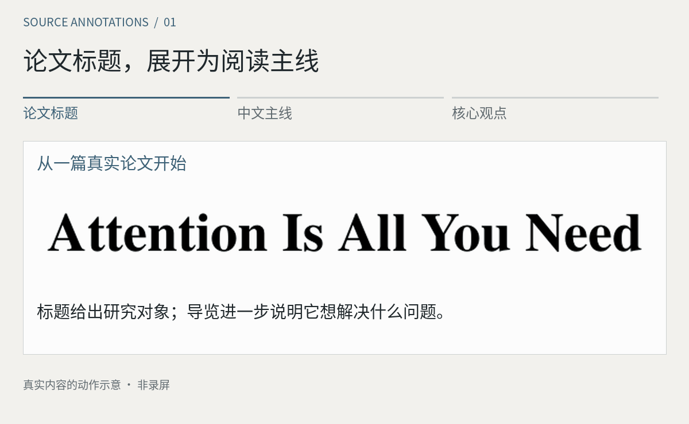
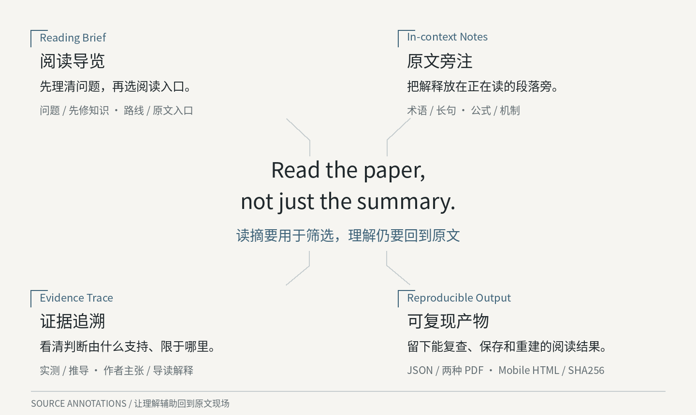
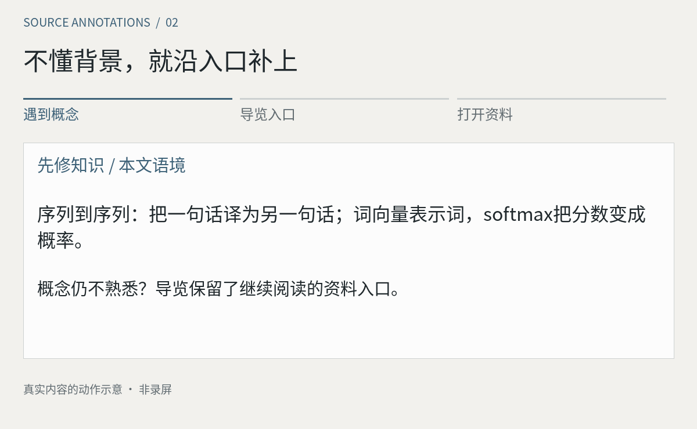
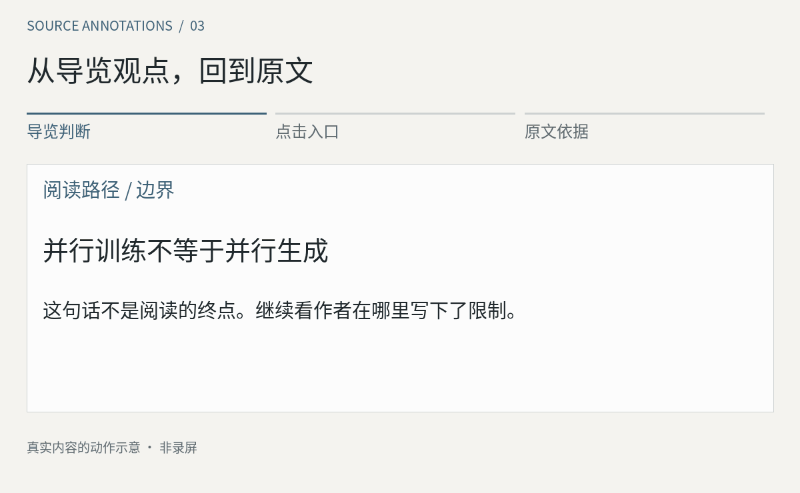
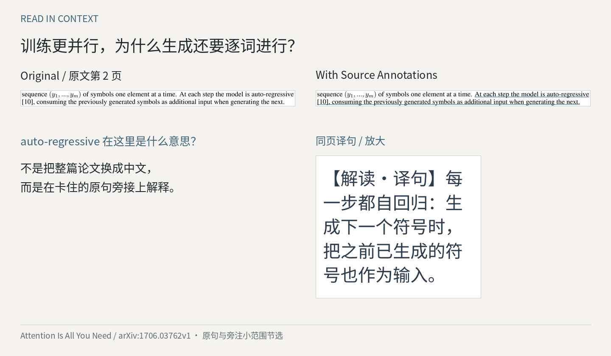

# Source Annotations

**Read the paper, not just the summary.**

把阅读导览、原文旁注和证据入口放在一起，**帮你亲自读进原论文**。

**主案例：《Attention Is All You Need》，固定 arXiv v1。**

[看导览预览](examples/attention-is-all-you-need/showcase/preview-guide.png) · [原论文](https://arxiv.org/abs/1706.03762v1) · [生成完整 PDF](examples/attention-is-all-you-need/README.md) · [三种用法与依赖](#快速开始)

<a href="examples/attention-is-all-you-need/README.md">
<picture>
  <source media="(prefers-reduced-motion: reduce) and (max-width: 600px)" srcset="examples/attention-is-all-you-need/showcase/motion-concept-mobile-still.png">
  <source media="(prefers-reduced-motion: reduce)" srcset="examples/attention-is-all-you-need/showcase/motion-concept-still.png">
  <source media="(max-width: 600px)" srcset="examples/attention-is-all-you-need/showcase/motion-concept-mobile.gif">
  
</picture>
</a>

*标题 → 中文主线 → 核心观点。基于现有导览的动作示意，非录屏或即时生成；[静态版](examples/attention-is-all-you-need/showcase/motion-concept-still.png)。*

## 摘要看懂了，正文却读不下去

一个陌生术语让你打开搜索页，一段长句又把你带进聊天窗口。回到公式时，你已经忘了它要解决哪个问题；看到提升数字，还得往回找比较对象和实验条件。

自己逐页精读能保留细节，但补背景、拆长句和找出处都得自己组织。只看 AI 总结虽然容易先获得答案，却可能说不清方法为什么这样设计、结论由什么支持。我们希望把找路和理解辅助交给工具，**把阅读、推敲和判断留给读者**。

| 读法 | 先得到什么 | 门槛与仍需完成的事 |
|---|---|---|
| 自己逐页精读 | 原文细节与完整语境 | 遇到知识缺口或难句时暂停查找；自己梳理主线和证据，容易反复切换 |
| 只看 AI 总结 | 问题和结论的快速概括，适合筛选 | 能复述概括，不一定理解推导和实验；还要回原文核对条件与出处 |
| **带着导览读原文** | **必要背景、阅读路线和可点击的证据入口** | 有准备地进入关键段落，亲自理解和查证；仍需核对 AI 解释，不能跳过原文 |

## 围绕读原文，做好四件事

<a href="examples/waypoint-opd/showcase/framework-overview.png">
<picture>
  <source media="(max-width: 600px)" srcset="examples/waypoint-opd/showcase/framework-mobile.png">
  
</picture>
</a>

### 导览的核心：补上前情，再把你送到值得细读的地方

- **补背景，让术语有来处。** 先解释概念在本文中的用法；讲不完的前情，接上入门资料和直接前序工作。样例先说明序列到序列、词向量和编码器/解码器，再连到 Seq2seq 与早期注意力论文，避免一上来就被术语挡住。
- **给读法，让阅读有主线。** 用简短核心观点串起问题、方法与发现，再安排“问题 → 方法 → 机制 → 证据 → 边界”的路径。每项带原文页码和建议用时，让你知道先读哪里、在哪里停下来核查，而不只得到一份重点清单。
- **连证据，让概括能被查证。** 样例导览有 **11 个 PDF 内部入口**，可直接进入对应原句、图表或公式的位置，不必重新翻找。不能精确定位时明确标为整页入口；读者可以继续检查作者的实验、假设和限制。

**AI 提供背景、路线和解释，你沿着它们回到原文形成自己的理解。** 旁注接住阅读中的词句和公式难点，可复现文件留下这次阅读的线索。

## 快速开始

### 依赖与环境

| 需要什么 | 实际要求 |
|---|---|
| Python 与 PDF 引擎 | **Python 3.11+**；`PyMuPDF==1.26.5`，用 `requirements.txt` 安装 |
| 字体 | Noto CJK 已随完整仓库放在 `assets/` |
| 模型与 API Key | 复现已有记录**不需要**；新论文需要能读 PDF、写文件和执行 Python 的智能体，是否需 API Key 取决于工具 |
| 下载 | ZIP 或 Git；首次安装依赖和下载原论文需网络 |
| 已验收环境 | **Windows / Python 3.13.5**；macOS/Linux 尚未完整验收 |

### 方式一：直接读样例

先看[Transformer 导览预览](examples/attention-is-all-you-need/showcase/preview-guide.png)与下面的动图，再打开[原论文](https://arxiv.org/abs/1706.03762v1)对照。完整的导览 PDF、标注 PDF 和手机 HTML 按方式二在本地生成；原文许可没有提供通用再分发授权，仓库不上传其全文副本。

如果想先下载一份现成的完整产物，原有 [Waypoint-OPD 标注 PDF](output/waypoint-opd-v1-annotated.pdf)、[导览 PDF](output/waypoint-opd-v1-reading-brief.pdf)和[手机 HTML](output/waypoint-opd-mobile.html)继续保留。HTML需下载后打开；“打开 PDF”按钮需要同名PDF放在同目录。内部跳转需阅读器支持。

### 方式二：本地复现样例

Windows PowerShell：

```powershell
git clone https://github.com/Levinesjob/source-annotations.git
cd source-annotations
python -m venv .venv
.\.venv\Scripts\python.exe -m pip install -r requirements.txt
.\.venv\Scripts\python.exe scripts/fetch_example.py --example attention-is-all-you-need
.\.venv\Scripts\python.exe scripts/prepend_guide.py local/attention-is-all-you-need-v1.pdf examples/attention-is-all-you-need/annotations.json local/attention-preview/attention-is-all-you-need-v1-reading-brief.pdf
.\.venv\Scripts\python.exe scripts/annotate.py local/attention-is-all-you-need-v1.pdf examples/attention-is-all-you-need/annotations.json local/attention-preview/attention-is-all-you-need-v1-annotated.pdf
.\.venv\Scripts\python.exe scripts/verify.py local/attention-is-all-you-need-v1.pdf examples/attention-is-all-you-need/annotations.json local/attention-preview/attention-is-all-you-need-v1-annotated.pdf
.\.venv\Scripts\python.exe scripts/mobile.py local/attention-is-all-you-need-v1.pdf examples/attention-is-all-you-need/annotations.json local/attention-preview/attention-is-all-you-need-mobile.html --pdf local/attention-preview/attention-is-all-you-need-v1-annotated.pdf
```

这是用**现成 JSON 重建导览、旁注和定位**，不会重新理解论文。两种 PDF 都含原文：本例是 1 页导览＋15 页论文。生成位置与版本细节见[主案例说明](examples/attention-is-all-you-need/README.md)，其他使用方式见[完整说明](docs/usage.md)。

### 方式三：用 Skill 读自己的论文

把完整目录安装到工具可发现的技能位置，不能只复制 `SKILL.md`。Codex、Cursor、Claude Code 的[目录与调用方式](docs/usage.md#安装为-skill)分别说明。

> 使用 `$source-annotations` 精读这篇论文。先做一页导览，讲清问题、前置知识和阅读路径，链接到原文证据；再为难词、长句、关键公式和结论添加少量旁注。保留原论文，报告未核验的解释。

新论文需要智能体重新通读和生成记录，不能只替换样例 PDF 路径。[通用文字指令](docs/plain-prompt.md)可用于其他聊天工具，但不保证能导出 PDF。

## 读起来是什么样

### 背景不熟？从概念进入基础资料

导览先用一两句话接上背景，讲不完的知识保留继续阅读的入口。下面从序列到序列概念进入 Seq2seq 前序论文；**先补上这块知识，再回论文继续读**。

<a href="https://arxiv.org/abs/1409.3215">
<picture>
  <source media="(prefers-reduced-motion: reduce) and (max-width: 600px)" srcset="examples/attention-is-all-you-need/showcase/motion-background-mobile-still.png">
  <source media="(prefers-reduced-motion: reduce)" srcset="examples/attention-is-all-you-need/showcase/motion-background-still.png">
  <source media="(max-width: 600px)" srcset="examples/attention-is-all-you-need/showcase/motion-background-mobile.gif">
  
</picture>
</a>

*真实 PDF 链接与目标资料摘记的动作示意；目标画面不是网页截图。点击本图可打开资料；[静态版](examples/attention-is-all-you-need/showcase/motion-background-still.png)。*

### 看懂一个判断，再追到原文

**导览里的概括有原文入口。** 动图用“并行训练不等于并行生成”演示：点击导览中的生成边界入口，定位到作者原句，继续核对上下文。

<a href="examples/attention-is-all-you-need/README.md">
<picture>
  <source media="(prefers-reduced-motion: reduce) and (max-width: 600px)" srcset="examples/attention-is-all-you-need/showcase/motion-evidence-mobile-still.png">
  <source media="(prefers-reduced-motion: reduce)" srcset="examples/attention-is-all-you-need/showcase/motion-evidence-still.png">
  <source media="(max-width: 600px)" srcset="examples/attention-is-all-you-need/showcase/motion-evidence-mobile.gif">
  
</picture>
</a>

*动画按成品 PDF 的真实 GoTo 位置演示，非阅读器录屏。请在 PDF 中实际点击；[静态版](examples/attention-is-all-you-need/showcase/motion-evidence-still.png)。*

### 继续读正文，解释就在原句旁

**读到长句，解释就留在旁边。** 下图上方是同页、同坐标的原句；右下是同页直译放大，帮你接上“自回归”的意思。

[](examples/attention-is-all-you-need/showcase/before-after.png)

实测、推导、作者主张、导读解释分开标记，不把辅助解释当作作者结论。完整空间关系可在本地生成的标注PDF中查看。

## 验证与边界

主案例为 **15页原文＋1页导览、34条标注、11个内部入口、5处公式解释**。主案例更新在 main；[v0.1.0-preview.1](https://github.com/Levinesjob/source-annotations/releases/tag/v0.1.0-preview.1)保留发布时的 Waypoint-OPD 样例。

智能体起草解释，脚本负责版本校验、原句定位、绘制与机械检查。**机械检查通过不代表解释正确**。新案例已逐项对照原文并检查版式，独立模型复核、人类专业审查和真实手机操作仍未完成；45分钟仍是阅读预算，**没有量化提速结果**。既有23项自动测试与三类论文44页的导览回归是原工程记录，不等于新论文已经完成全部验收。

只插导览与正文旁注是两条路径：前者验证了原页内容及部分结构保留；后者重建研究页，遇到原有人工批注或表单会拒绝，不能假定完整保留交互对象。扫描、旋转、异常裁剪及复杂结构的范围见[工程说明](docs/architecture.md)。

[实际验收](review/STATUS.md) · [回归记录](review/ACADEMIC-REGRESSION.md) · [主案例标注 JSON](examples/attention-is-all-you-need/annotations.json) · [主案例验收记录](review/ATTENTION-2026-10-18.md)

## 许可与反馈

新增代码、指令和中文解释采用 [MIT](LICENSE)；Waypoint-OPD 原文为 **CC BY 4.0**；Attention 原文适用 arXiv 非独占分发许可，完整副本仅在本地生成，原文及小范围引用不受本仓库 MIT 覆盖。Noto 字体为 **SIL OFL 1.1**。PyMuPDF 适用 **AGPL／商业双许可**，本项目 MIT 不覆盖依赖条款。见[第三方说明](THIRD_PARTY_NOTICES.md)。

欢迎[报告具体阅读卡点或错误](https://github.com/Levinesjob/source-annotations/issues/new?template=feedback.yml)：论文版本、页码、哪条解释或跳转出了问题。请移除私人和公司材料。
