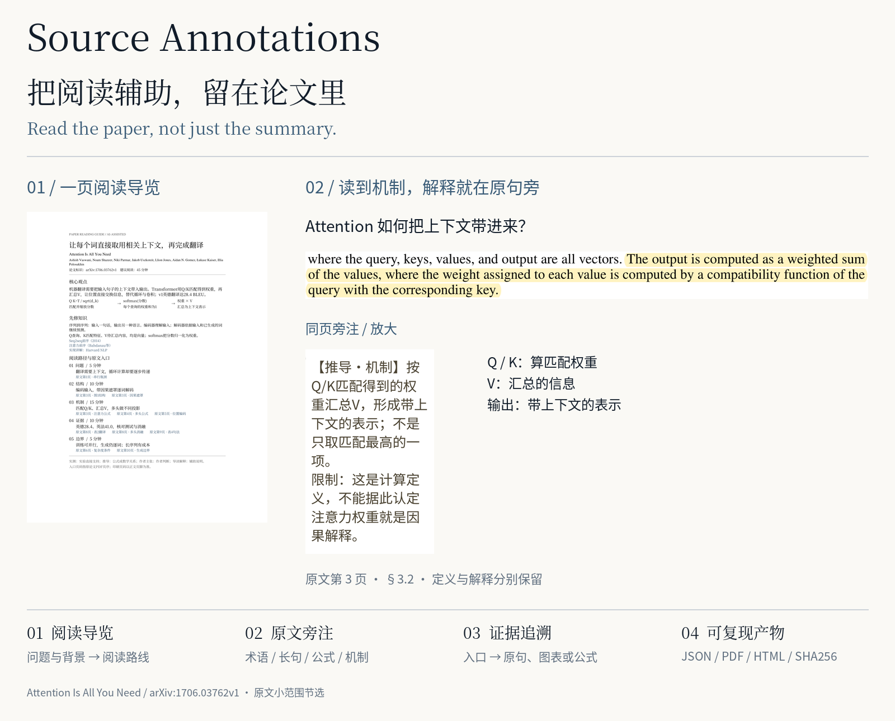
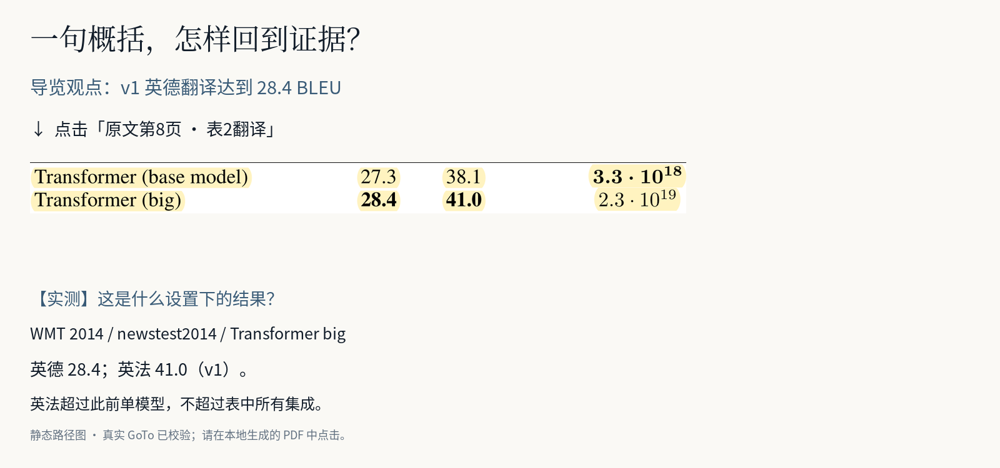

# Source Annotations

**把论文的阅读辅助，留在论文里。**

给原论文加一页中文阅读导览和同页旁注：**先补背景、找到阅读主线，再读原句、看懂难点、跳回证据。** 这是一个可安装的 Agent Skill 和一组本地 Python 脚本。

Read the paper, not just the summary.

[看真实效果](docs/showcase.md) · [下载预览版](https://github.com/Levinesjob/source-annotations/releases/tag/v0.1.0-preview.2) · [本地生成](#2-本地复现现成样例) · [处理新论文](#3-安装-skill处理新论文) · [反馈问题](https://github.com/Levinesjob/source-annotations/issues/new?template=feedback.yml)

<picture>
  <source media="(max-width: 600px)" srcset="examples/attention-is-all-you-need/showcase/reading-poster-mobile.png">
  
</picture>

## 读到难处，解释就在旁边

陌生术语让你打开搜索页，长句让你反复回读，公式看完了却没明白为什么需要它。读到一个结论，又要翻回去找它的实验依据。几次切换之后，阅读主线容易断掉。

摘要适合筛选论文，也适合先看大意；真正理解仍需要自己读原文、核对条件。Source Annotations 把必要的辅助放回阅读现场：

| 阅读方式 | 能得到什么 | 还需要自己做什么 |
|---|---|---|
| 直接读 PDF，遇到难点再查 | 完整原文，自主安排阅读 | 切换工具后接回上下文，自己组织背景和证据 |
| 主要看 AI 摘要或问答 | 快速了解大意，围绕问题交流 | 回原文核查遗漏条件，亲自理解推导和实验 |
| 带导览和旁注读原文 | 阅读路径、就地解释、证据入口 | 仍要读原文并判断解释是否成立 |

**导览不只是摘要。** 它解释论文在解决什么问题，补充先修知识和已核对的资料链接；把阅读拆成最多五段，给出原文入口和时间预算。入口可跳到对应原句、图表或公式；旁注补上术语、长句和公式的解释。

当前真实案例是 **Attention Is All You Need，arXiv:1706.03762v1**：35 条标注、5 处公式解释、11 个内部入口。下面展示从导览到原文表 2 的证据路径；**图片是静态说明，实际跳转需在本地生成的 PDF 或 HTML 中操作。**

<picture>
  <source media="(max-width: 600px)" srcset="examples/attention-is-all-you-need/showcase/evidence-trace-mobile.png">
  
</picture>

[查看完整导览](examples/attention-is-all-you-need/showcase/preview-guide.png) · [查看机制说明图](examples/attention-is-all-you-need/showcase/attention-explained.png) · [样例数据与来源](examples/attention-is-all-you-need/README.md)

## 怎么用

### 1. 先看已有成果

无需安装，打开上面的展示和[阅读导览](examples/attention-is-all-you-need/showcase/preview-guide.png)，对照[固定 v1 原论文](https://arxiv.org/abs/1706.03762v1)。公开仓库提供导览预览、少量原文节选和标注数据；**完整 Attention 标注 PDF、导览插页 PDF 与 HTML 需本地生成**，不附未经许可的全文副本。

### 2. 本地复现现成样例

需要 **Python 3.11+、PyMuPDF 1.26.5**；中文字体和许可随仓库提供。下面使用 Windows PowerShell，在新目录克隆后执行：

不使用 Git 时，可在[预览版发布页](https://github.com/Levinesjob/source-annotations/releases/tag/v0.1.0-preview.2)下载 Source code ZIP，解压后进入包含 `SKILL.md` 的目录，从 `python -m venv .venv` 开始运行。仓库包含完整 CJK 字体，首次获取源码较大。

```powershell
git clone --depth 1 https://github.com/Levinesjob/source-annotations.git
cd source-annotations
python -m venv .venv
.\.venv\Scripts\python.exe -m pip install -r requirements.txt
.\.venv\Scripts\python.exe scripts/fetch_example.py
.\.venv\Scripts\python.exe scripts/annotate.py local/attention-is-all-you-need-v1.pdf examples/attention-is-all-you-need/annotations.json local/reproduced.pdf
.\.venv\Scripts\python.exe scripts/verify.py local/attention-is-all-you-need-v1.pdf examples/attention-is-all-you-need/annotations.json local/reproduced.pdf
```

打开 `local/reproduced.pdf`，从第一页点击蓝色入口；输出共 16 页，包含一页导览和 15 页原文。首次安装和原文下载需要网络；**复现已有 JSON 不调用模型、不需要 API key**。导览单独插页、HTML 导出、关键页生成及测试命令见[完整使用说明](docs/usage.md)。

### 3. 安装 Skill，处理新论文

将仓库**完整目录**放到智能体的 Skill 目录，保留 `assets/`、`references/` 和 `scripts/`，按[安装说明](docs/usage.md#安装为-skill)选择工具对应路径。需要能读取全文、操作文件并执行 Python 的智能体。

给它一篇可处理的 PDF，例如：

> 使用 source-annotations，为这篇论文生成中文阅读导览和同页旁注。我了解基础机器学习，但不了解这篇论文的方法；请补充必要背景，解释关键术语和公式，并把重要判断链接回原文证据。

**AI 负责通读、选择重点、写解释和生成新 JSON；脚本负责引文定位、排版与机械检查。** 新论文需要新记录，不能只替换样例 PDF 路径。没有文件执行环境时，可用[通用文字指令](docs/plain-prompt.md)试读，但不保证生成 PDF。

## 验证与边界

- 主要验证环境：**Windows / Python 3.13.5 / PyMuPDF 1.26.5**。macOS/Linux 尚未完整验收；静态图生成用的 Pillow 是可选依赖。
- 机械测试检查引文定位、版式、链接及对应路径的 PDF 保留规则；完整独立内容审查和真实手机操作尚未完成。HTML 沿用 PDF 页面，需缩放阅读，不是文字重排版。
- 阅读分钟数是预算，**没有证明阅读提速或准确率提升**。解释可能出错，实测、推导、作者主张与导读解释分别标记，便于回查。
- 只插导览与正文标注的结构保留范围不同；加密、扫描及复杂 PDF 不能一概承诺兼容。见[工程边界](docs/architecture.md)和[验证记录](review/STATUS.md)。

遇到安装失败、解释错误、难以阅读或跳转问题，请[提交反馈](https://github.com/Levinesjob/source-annotations/issues/new?template=feedback.yml)，附操作步骤或原句位置。[待办](TODO.md)记录未完成项；[项目计划](PROJECT.md)记录发布范围。

代码和自写解释采用 [MIT](LICENSE)；原论文、字体与 PDF 引擎各自许可见[第三方说明](THIRD_PARTY_NOTICES.md)。历史 [v0.1.0-preview.1](https://github.com/Levinesjob/source-annotations/releases/tag/v0.1.0-preview.1) 是旧案例，当前 Attention 案例以本页和仓库代码为准。
