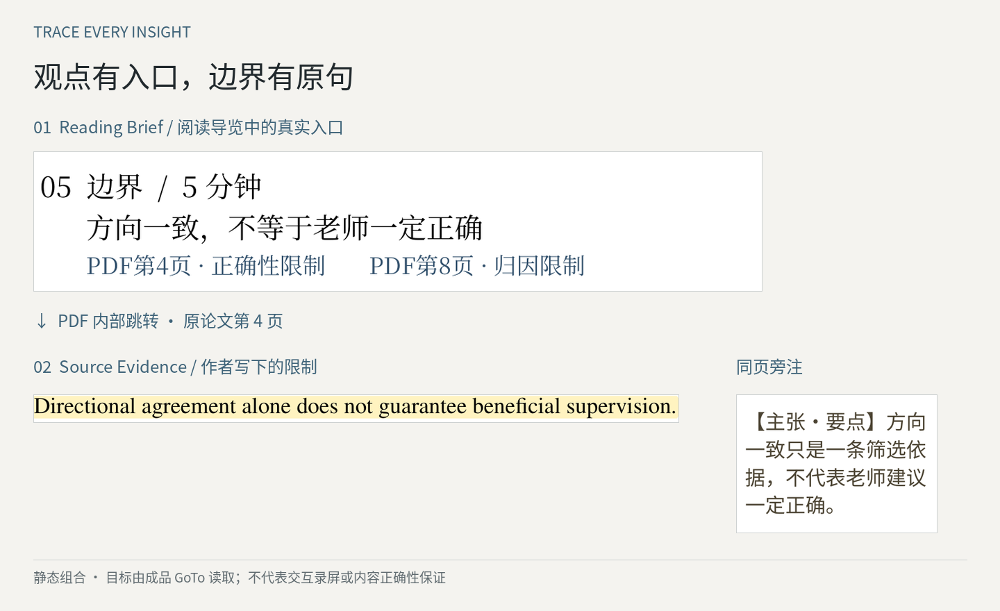
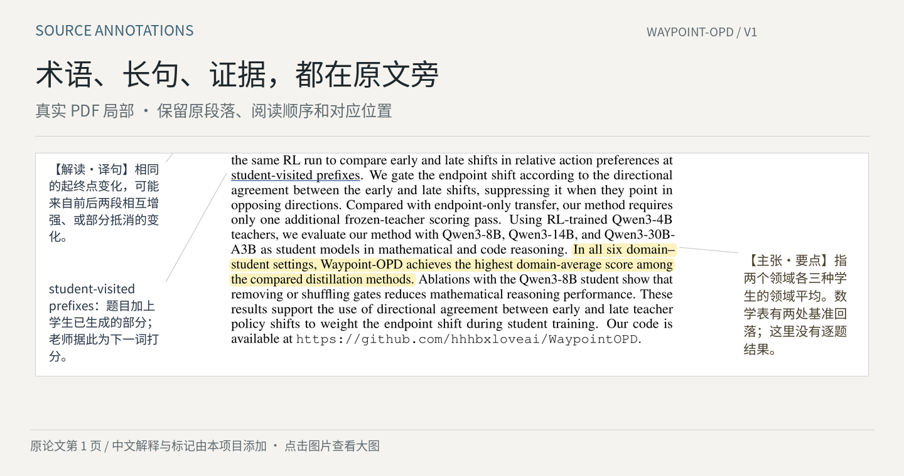
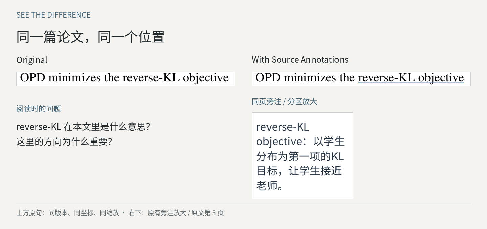

# Source Annotations

**Read the paper, understand it in place.**

### 帮助读者亲自理解原论文

一篇摘要可以帮助我们判断论文是否值得读，却很难交代完整的方法细节、实验条件和结论边界。AI 能很快整理重点，但如果始终只看整理后的答案，理解也容易停留在答案里。真正弄清楚作者做了什么、为什么这样做，以及证据能支持到哪一步，还是要回到原文。

**Source Annotations 想做的，是让回到原文这件事更轻松。** 先用一页中文导览理清研究问题、前置知识与阅读路线，再直接跳到值得细读的原句、公式和图表；读的过程中，必要的术语、长句和机制解释就放在对应位置旁边，尽量减少查词、切换窗口和反复找出处的打断。

它不替代你的阅读和判断，而是帮你把注意力留在论文上。

**[先看阅读导览 PDF](output/waypoint-opd-v1-reading-brief.pdf)** · **[看带旁注的 PDF](output/waypoint-opd-v1-annotated.pdf)** · [快速开始](#快速开始) · [完整使用说明](docs/usage.md)

## 先有方向，再读原文

导览不是把 Abstract 再翻译一遍，而是一张可以点击的**阅读地图**：

- **读之前**，用简短的背景解释补上理解这篇论文所需的前提，指出它究竟在解决什么问题。
- **开始读**，围绕问题、方法、机制、证据和边界安排阅读顺序，告诉你哪些地方值得花时间。
- **读到关键处**，点击入口回到论文的具体原句、图表或公式；无法精确定位时明确使用整页入口，而不伪装成精确引用。

不必从第一页硬读到最后一页，也不必被别人整理的摘要限制住理解。可以先顺着导览抓住主线，再根据自己的疑问回原文细读。

<a href="examples/waypoint-opd/showcase/evidence-navigation.png"><picture>
  <source media="(max-width: 600px)" srcset="examples/waypoint-opd/showcase/evidence-mobile.png">
  
</picture></a>

*上图展示导览到原文证据的关系，是根据真实 PDF 跳转位置制作的静态组合图；在 [PDF](output/waypoint-opd-v1-reading-brief.pdf) 中可直接点击链接。示例建议用 45 分钟掌握研究主线，这是阅读预算，不是已经测出的提速结果。*

## 读的过程中，少一点打断

查一个术语、拆一段长句，或寻找公式解释，都可能打断阅读。我们尽量把这些辅助信息放回原文附近：

- **术语**：解释这个词在*本文*中是什么意思，而不是贴一整段词典释义。
- **长句**：保留原句的条件、否定和比较对象，避免“翻译明白了，意思却变了”。
- **公式**：说明符号代表什么、如何计算、为什么这样设计，和原论文的例子相互对照。
- **结论与证据**：重点高亮对应原句，并区分实验结果、数学推导、作者观点和辅助解释。

<a href="examples/waypoint-opd/showcase/hero.png"><picture>
  <source media="(max-width: 600px)" srcset="examples/waypoint-opd/showcase/hero-mobile.png">
  
</picture></a>

[](examples/waypoint-opd/showcase/before-after.png)

*图片取自同一版本的 Waypoint-OPD 论文和本项目生成的标注 PDF。主图保留原文与批注的空间关系；对比图上方使用同坐标原句，右下为同页旁注的单独放大。窄屏可点击大图；完整样例见 [标注 PDF](output/waypoint-opd-v1-annotated.pdf)。*

## 从概括到证据，再到自己的理解

导览负责指出“先读哪里”，正文批注负责减少理解障碍，原文链接负责让每个重要判断有出处。三者配合，目标不是把一篇论文压缩成几张卡片，而是让读者能够沿着**核心问题 → 作者方法 → 原文证据 → 适用限制**形成自己的认识。

本项目使用结构化记录保存论文版本、原句、页码及解释；匹配不到原句、出现歧义或版面冲突时，生成脚本会停止，而不会猜一个位置。智能体负责通读、选重点和起草解释；确定性脚本负责原句匹配、坐标、绘制和机械检查，本身不调用模型。人工或独立模型负责内容审查；**机械检查通过不等于学术解释一定正确**。

[查看样例标注数据](examples/waypoint-opd/annotations.json) · [查看工程原理](docs/architecture.md) · [查看实际验收](review/STATUS.md)

## 快速开始

这里有三种使用方式，按你自己的需要选择。

### 方式一：直接体验，不需要安装

下载 [只有导览的 PDF](output/waypoint-opd-v1-reading-brief.pdf)，先看第一页，再点击其中的原文入口。请下载后用支持 PDF 内部链接的阅读器打开；也可以下载 [完整标注 PDF](output/waypoint-opd-v1-annotated.pdf)，直接阅读原文旁的解释。

如需手机浏览器入口，下载 [手机 HTML](output/waypoint-opd-mobile.html)，使用浏览器打开。页图已内嵌，可单独离线阅读；若要使用“打开 PDF”按钮，还需把完整标注 PDF 按原文件名放在同一个文件夹。GitHub 文件页不会运行 HTML，窄屏仍需要缩放。

### 方式二：在电脑上复现这个示例

**依赖与环境**

| 项目 | 要求或说明 |
| --- | --- |
| Python | **3.11 或更高**；已验证 Windows / Python 3.13.5 |
| PDF 依赖 | `PyMuPDF==1.26.5`，由 `requirements.txt` 安装 |
| 中文字体 | 所需 Noto CJK 字体已包含在完整仓库的 `assets/` 内 |
| Git | 用 `git clone` 下载时需要；也可以下载仓库 ZIP |
| 网络 | 首次安装依赖、下载示例原论文时需要 |
| AI / API Key | **复现现有数据不需要模型或 API Key**；新论文需要智能体阅读并生成记录，是否需 API Key 取决于所用工具 |

仅重新制作 README 展示图时另需 `requirements-showcase.txt` 中的 Pillow；复现 PDF 不需要它。

在 **Windows PowerShell** 中运行（macOS/Linux 的解释器路径见 [使用说明](docs/usage.md)，尚未在这些系统完整验收）：

```powershell
git clone https://github.com/Levinesjob/source-annotations.git
cd source-annotations
python -m venv .venv
.\.venv\Scripts\python.exe -m pip install -r requirements.txt
.\.venv\Scripts\python.exe scripts/fetch_example.py

# 在原论文前插入一页导览（此样例输出共21页）
.\.venv\Scripts\python.exe scripts/prepend_guide.py local/waypoint-opd-v1.pdf examples/waypoint-opd/annotations.json local/reproduced-guide.pdf

# 再生成带原文旁注的阅读版
.\.venv\Scripts\python.exe scripts/annotate.py local/waypoint-opd-v1.pdf examples/waypoint-opd/annotations.json local/reproduced.pdf
.\.venv\Scripts\python.exe scripts/verify.py local/waypoint-opd-v1.pdf examples/waypoint-opd/annotations.json local/reproduced.pdf
```

这些命令使用**仓库预置的示例标注数据**，重现排版与定位流程，不会自动重新阅读论文，也不会调用模型。完整手机输出、测试及更多命令见 [docs/usage.md](docs/usage.md)。

### 方式三：作为 Skill 处理你自己的论文

需要支持 Agent Skills、能够读取 PDF、写文件并运行本地 Python 的工具或智能体。安装时复制**完整仓库目录**，不是只放一个 `SKILL.md`：

| 工具 | 技能目录示例 | 使用方式 |
| --- | --- | --- |
| Codex | 用户 `~/.agents/skills/source-annotations/`，或项目 `.agents/skills/source-annotations/` | 提示词中调用 `$source-annotations` |
| Cursor | 项目 `.cursor/skills/source-annotations/`，或用户 `~/.agents/skills/source-annotations/` | 在对话中指定使用该 Skill |
| Claude Code | `~/.claude/skills/source-annotations/` | 调用 `/source-annotations` |

可以这样提出需求：

> 使用 `$source-annotations` 处理这篇论文。请先通读并做一页阅读导览，说明研究问题、必要前置知识、值得先读的机制与实验，并在导览中给出真实的原文跳转。随后为难词、长句、关键公式和证据制作少量高质量的原文旁注。保留原论文，报告尚未核验的解释。

新论文需要重新分析、生成对应的结构化标注记录；不能直接替换样例 PDF 路径就完成理解。Codex 目录按[当前官方说明](https://learn.chatgpt.com/docs/build-skills#where-codex-loads-local-skills)列出；本机此前的 `~/.codex/skills/` 安装记录仍保留，不把它作为所有版本的通用目录。Skill 的发现方式随工具版本而变化；安装和已验证能力见 [完整使用说明](docs/usage.md#安装为-skill)。

## 当前支持范围

这是 **v0.1.0 Preview**，已发布版本为 [v0.1.0-preview.1](https://github.com/Levinesjob/source-annotations/releases/tag/v0.1.0-preview.1)，提供一条可以复现的真实论文阅读流程。

- 当前样例：**一页导览 + 20 页原论文，44 条精选标注**。
- 已报告通过：**23 项自动测试**；仅插导览流程在三类真实论文、共 44 页原研究内容上做过回归。
- 尚未完成：当前44条解释与新导览的完整独立复核、全部逐条专业审查、最新移动端实机完整操作，以及阅读速度和理解质量的对照测量。
- 首版主要处理带文字层的英文 PDF；扫描、旋转或异常裁剪文件尚不支持自动处理。
- **仅插导览**与**生成正文旁注**是两条不同 PDF 路径；前者经过原页内容与部分结构保留检查，后者会重建研究页，不能假定保留原 PDF 的全部交互对象。

更详细的边界见 [实际验收记录](review/STATUS.md)、[回归记录](review/ACADEMIC-REGRESSION.md) 和 [工程说明](docs/architecture.md)。

## 许可与反馈

本项目新增代码、指令和中文解释使用 [MIT](LICENSE)；样例原论文为 **CC BY 4.0**，Noto 字体使用 **SIL OFL 1.1**。依赖的 **PyMuPDF 适用 AGPL／商业双许可**，项目自身的 MIT 不会覆盖第三方依赖许可。详见 [第三方说明](THIRD_PARTY_NOTICES.md)。

如果某条批注遗漏了条件、误读了公式，或者导览跳错了位置，欢迎通过 [Issues](https://github.com/Levinesjob/source-annotations/issues/new?template=feedback.yml) 说明论文版本、页码与具体问题。这样的反馈比单纯增加标注数量更有帮助。

请先移除私人或公司材料。[改稿差异与本轮验证结果](docs/readme-review.md)。
