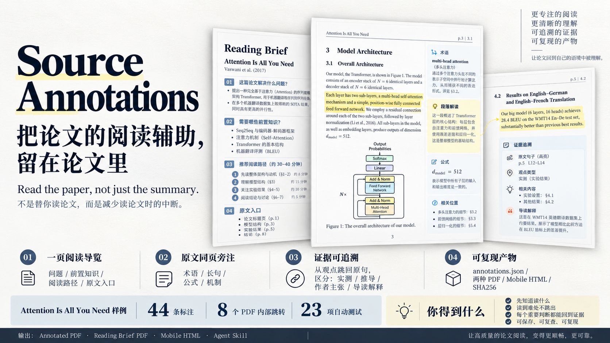

# Source Annotations

图为功能示意；当前 Attention v1 样例为 **35 条标注、11 个内部跳转，已有 24 项测试通过记录**。

[查看一页导览](examples/attention-is-all-you-need/showcase/preview-guide.png) · [安装与使用](docs/usage.md) · [标注数据](examples/attention-is-all-you-need/annotations.json) · [验收状态](review/STATUS.md)

## 开始使用

复现已有样例无需模型或 API Key，需要 Python 3.11+ 和 requirements.txt 中的依赖。生成 PDF 与手机 HTML 的命令，以及 Skill 安装方式，见[完整用法](docs/usage.md)。全文产物仅本地生成。

独立内容审查、真实手机操作及阅读计时待完成。见[待办](TODO.md)。

代码及自写解释采用 [MIT](LICENSE)；原论文、字体及 PDF 引擎许可见[第三方说明](THIRD_PARTY_NOTICES.md)。[反馈问题](https://github.com/Levinesjob/source-annotations/issues/new?template=feedback.yml)
