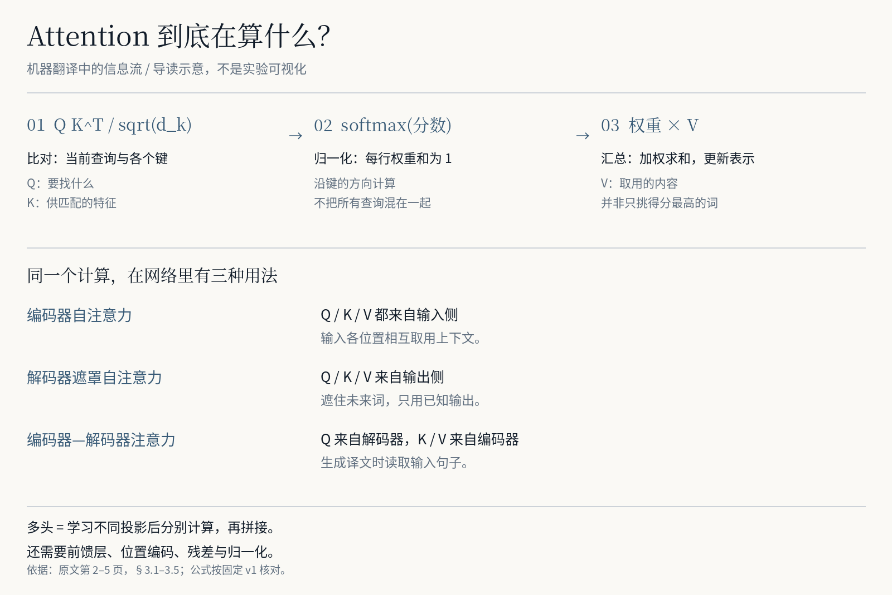

# Source Annotations

**把论文的阅读辅助，留在论文里。**<br>
Read the paper, not just the summary.

先用一页导览补背景、找主线，再带着术语、长句和公式解释读原文；重要判断可以直接回到证据。

[看一页导览](examples/attention-is-all-you-need/showcase/preview-guide.png) · [读原论文](https://arxiv.org/abs/1706.03762v1) · [本地生成 PDF](#快速开始) · [标注数据](examples/attention-is-all-you-need/annotations.json)

<picture>
  <source media="(max-width: 600px)" srcset="examples/attention-is-all-you-need/showcase/reading-poster-mobile.png">
  
</picture>

## 摘要看懂了，正文还是会卡住

一个术语让你去搜索，一段长句又把你带进聊天窗口。回到公式时，已经忘了它要解决什么问题；看到结果，还得找实验条件。摘要适合筛选，**理解方法与证据，仍要自己读原文**。

| 读法 | 阅读过程中会发生什么 |
|---|---|
| 自己逐页精读 | 自己补背景、拆句、找证据；来回切换容易打断上下文 |
| 只让 AI 总结 | 快速得到概括；不一定能解释公式、比较条件和结论依据 |
| **带着导览读原文** | **先知道任务与路线，难点在原句旁解释，结论有可点击的证据入口** |

## 用 Attention Is All You Need 看一次

### 先看懂它在做什么

机器翻译把输入句子转成另一种语言。本文的关键不只是“训练更快”，而是**用注意力进行位置之间的信息交互，组成不依赖循环与卷积的编码器—解码器**。Q/K 决定取用信息的权重，V 提供要汇总的内容；前馈层、位置编码、残差与归一化仍在。

<picture>
  <source media="(max-width: 600px)" srcset="examples/attention-is-all-you-need/showcase/attention-explained-mobile.png">
  
</picture>

[一页导览](examples/attention-is-all-you-need/showcase/preview-guide.png)把问题、先修知识、阅读顺序和原文入口放在一起。背景不足时，可继续读[Seq2seq 前序](https://arxiv.org/abs/1409.3215)、[早期注意力工作](https://arxiv.org/abs/1409.0473)或[Harvard 实现讲解](https://nlp.seas.harvard.edu/annotated-transformer/)。

### 再沿入口核对证据

<picture>
  <source media="(max-width: 600px)" srcset="examples/attention-is-all-you-need/showcase/evidence-trace-mobile.png">
  
</picture>

图是静态说明，**实际跳转在生成的 PDF / HTML 中操作**。旁注区分实测、推导、作者主张与导读解释。图中原文均是固定 v1 的少量节选；不是虚构界面，也不是即时生成演示。

## 快速开始

### 依赖

| 需要什么 | 当前要求 |
|---|---|
| 运行环境 | **Python 3.11+ / PyMuPDF 1.26.5**；字体在仓库 `assets/` 中 |
| 复现已有样例 | 不需要模型或 API Key；首次下载论文和安装依赖需要网络 |
| 处理新论文 | 需要能阅读文件、写 JSON、执行 Python 的智能体；模型费用依所用工具而定 |
| 已验证平台 | Windows / Python 3.13.5；macOS、Linux 未完整验收 |

### 方式一：先看现有示例

打开[中文导览预览](examples/attention-is-all-you-need/showcase/preview-guide.png)，对照[原论文 v1](https://arxiv.org/abs/1706.03762v1)。完整标注 PDF、导览插页 PDF 和手机 HTML 按下面步骤生成；原文许可未提供本项目上传全文副本的通用授权。

### 方式二：本地重建同一份阅读结果

<details>
<summary>Windows PowerShell：安装、下载、生成、校验</summary>

```powershell
git clone https://github.com/Levinesjob/source-annotations.git
cd source-annotations
python -m venv .venv
.\.venv\Scripts\python.exe -m pip install -r requirements.txt
.\.venv\Scripts\python.exe scripts/fetch_example.py --example attention-is-all-you-need
.\.venv\Scripts\python.exe scripts/prepend_guide.py local/attention-is-all-you-need-v1.pdf examples/attention-is-all-you-need/annotations.json local/attention-preview/attention-is-all-you-need-v1-reading-brief.pdf
.\.venv\Scripts\python.exe scripts/annotate.py local/attention-is-all-you-need-v1.pdf examples/attention-is-all-you-need/annotations.json local/attention-preview/attention-is-all-you-need-v1-annotated.pdf
.\.venv\Scripts\python.exe scripts/verify.py local/attention-is-all-you-need-v1.pdf examples/attention-is-all-you-need/annotations.json local/attention-preview/attention-is-all-you-need-v1-annotated.pdf
.\.venv\Scripts\python.exe scripts/mobile.py local/attention-is-all-you-need-v1.pdf examples/attention-is-all-you-need/annotations.json local/attention-preview/attention-is-all-you-need-mobile.html --pdf local/attention-preview/attention-is-all-you-need-v1-annotated.pdf
```

</details>

输出在 `local/attention-preview/`：两种 PDF 均为 **1 页导览＋15 页原文**，HTML 使用同一标注 PDF 的页面与跳转。现成 JSON 只重建结果，不会重新分析论文。[完整用法](docs/usage.md) · [案例与来源](examples/attention-is-all-you-need/README.md)

### 方式三：安装 Skill，处理自己的论文

把完整仓库放入智能体的技能目录，不能只复制 `SKILL.md`。见[安装与调用方式](docs/usage.md#安装为-skill)。

> 使用 `$source-annotations` 阅读这篇论文。先讲清任务、输入输出与关键机制，制作一页可跳转的阅读导览；再为原文中的术语、长句、公式和关键发现补充少量旁注，明确证据与限制。

智能体负责通读、理解和起草，脚本负责版本核对、定位、排版和导出。新论文需要新的标注记录，不能只换 PDF 路径。其他工具可参考[通用文字指令](docs/plain-prompt.md)，不保证能导出 PDF。

## 验证与边界

- 当前案例有 **35 条标注、5 处公式解释、11 个 PDF 内部入口**；所有正文主图表均有同页标注，机械覆盖检查不等于内容已获专业认可。
- 固定 2017 年 **v1**：英法结果为 **41.0 BLEU**。训练可并行不等于生成可同时完成；注意力仍有随序列长度增长的计算成本。
- 独立内容审查和真实手机验收待完成；45 分钟是阅读预算，**未证明提速或准确率提升**。
- 插导览路径保留原页对象；旁注路径有不同的结构限制。扫描、旋转和复杂交互对象见[工程说明](docs/architecture.md)。

[当前验收](review/STATUS.md) · [改版记录](review/ATTENTION-STATIC-2026-10-18.md) · [待办](TODO.md) · [展示图来源与复现](docs/showcase.md)

## 许可与反馈

新增代码、指令和中文解释采用 [MIT](LICENSE)。原论文和少量引文归原作者；Noto 字体为 SIL OFL 1.1；PyMuPDF 为 AGPL／商业双许可。[第三方说明](THIRD_PARTY_NOTICES.md)

[反馈具体卡点或错误](https://github.com/Levinesjob/source-annotations/issues/new?template=feedback.yml)：请附论文版本、页码，以及哪句解释或哪个入口出了问题，并移除私人资料。
