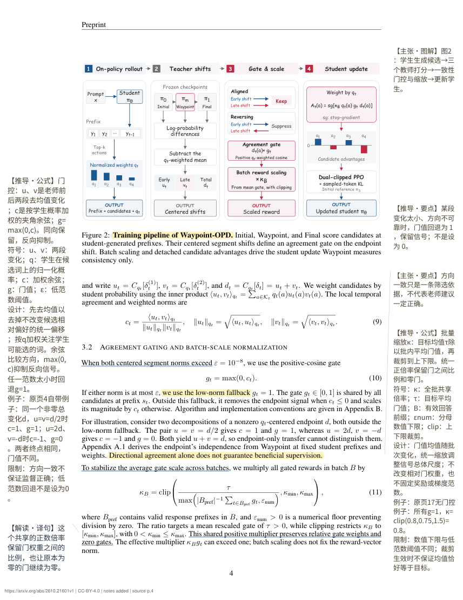

# 原文重点标注 · source-annotations

**把难词、长句和关键条件放回论文旁边，让你读原文时少来回查。**

这是一个 AI skill 和 PDF 生成工具。智能体负责阅读与解释，脚本负责定位原句、高亮和放置批注。**脚本本身不会读懂论文，也不调用模型。** 需要时可先给一条按时间预算安排的阅读路线，让读者先抓问题、机制、证据与边界。

**状态：v0.1.0-preview.1 公开试用版，尚未满足正式验收条件。** 独立审查、作者审查与手机验收进度见 [验收记录](review/STATUS.md)。不承诺阅读效率提升，不替代专业判断。



## 先看效果

- [手机原页阅读](output/waypoint-opd-mobile.html)：与PDF相同的完整页面，保留原文与批注的相对位置；支持缩放、原页跳转和点击批注定位原句。下载后用浏览器打开。
- [原页标注样例](output/waypoint-opd-v1-annotated.pdf)：1页简洁路线＋原论文20页，44条精选标注；公式说明放在原页3–4旁。
- [可编辑标注](examples/waypoint-opd/annotations.json)：每条保留原句、页码与解释依据。
- [只加学术导览的版本](output/waypoint-opd-v1-reading-brief.pdf)：前置一页academic-native导览，原研究页保持不变，保留链接、书签和元数据。
- [首页前后对比](examples/waypoint-opd/guide-before-after.png)与[三类真实论文回归记录](review/ACADEMIC-REGRESSION.md)。本案例p3–4已通过不扩边试排，批注最低9pt。
- [原论文 v1](https://arxiv.org/abs/2610.21601v1)：Bingxi Hou 等，CC BY 4.0。样例增加中文解释、高亮和必要页边距，未修改作者正文。

适合已有一些领域基础、想继续读原文的人。无法仅靠翻译补齐全部数学或专业背景。

## 最短试用路径

下载或克隆**完整仓库**，保留字体、脚本和样例。使用 Python 3.11+，在仓库根目录执行：

```sh
python -m venv .venv
```

Windows PowerShell：

```powershell
.\.venv\Scripts\python.exe -m pip install -r requirements.txt
.\.venv\Scripts\python.exe scripts/fetch_example.py
.\.venv\Scripts\python.exe scripts/annotate.py local/waypoint-opd-v1.pdf examples/waypoint-opd/annotations.json output/waypoint-opd-v1-annotated.pdf
.\.venv\Scripts\python.exe scripts/mobile.py local/waypoint-opd-v1.pdf examples/waypoint-opd/annotations.json output/waypoint-opd-mobile.html
.\.venv\Scripts\python.exe scripts/verify.py local/waypoint-opd-v1.pdf examples/waypoint-opd/annotations.json output/waypoint-opd-v1-annotated.pdf
.\.venv\Scripts\python.exe -m unittest discover -s tests -v
```

macOS/Linux 可将上述解释器替换为 `.venv/bin/python`；**首版尚未在这两类系统实测**。

示例已含 AI 生成的标注数据，上述命令仅复现排版。下载脚本只取得固定 v1 并校验哈希，不下载模型、不需要 API 密钥。首次下载和安装依赖需要网络。

本机已固化的调用入口及范围见[全局安装记录](docs/global-install.md)。

## 用它读新论文

只需前置导览时，准备同一数据格式并执行：

```sh
python scripts/prepend_guide.py 原论文.pdf 导览数据.json 新文件.pdf
```

先分析原纸张、版心、字体与栏数，再用原生可检索字体排版；导览前置一页，GoTo和书签只偏移一次，原始输入不覆盖。此路径与旧正文标注路径的结构保留范围不同，详见[规范与限制](references/academic-style.md)。

真实论文回归：先运行`python scripts/fetch_example.py`，再运行`python scripts/regression_academic.py --fetch`取得哈希校验的CVPR ResNet与Adam。回归PDF仅保留在`local/`，不随包分发；这验证导览与插页，不等于三篇均已通过全文标注质量验收。

把完整目录放入支持 Agent Skills 的工具可发现的技能目录，以该工具的技能安装机制为准。Codex的全局安装目录可使用 `~/.codex/skills/source-annotations/`；Cursor的项目安装目录可使用 `.cursor/skills/source-annotations/`（[官方说明](https://cursor.com/docs/skills)）。安装识别与实际生成的验证范围见验收记录，不能把格式兼容当作已完成实测。

示例请求：

> 使用 source-annotations 为这份论文制作精读批注。先通读正文，再按 references/pdf-workflow.md 生成标注记录并调用随包脚本。词义解释本文语境，长句保留条件与否定；重点包括机制、结果和限制。保留原文件，报告未完成项。

其他聊天工具可使用 [通用文字指令](docs/plain-prompt.md) 生成解释列表，但不保证支持原页标注、坐标定位或 PDF 导出。

## 如何检查结果

1. 对照原句，核对解释有没有丢掉限定、否定和比较对象。
2. 检查黄色重点是否真支撑结论，而不是只因为句子长。
3. 逐页看遮挡、错位、乱码和过小字体；手机打开同一文件再看一次。
4. 将来源、AI解释和自己的判断分开，不把生成成功当作内容正确。

词义保留完整原词组，批注默认9.5pt、不低于9pt；英文单词不从中间拆开。优先精选、缩短，再缩小字体，必要时增加页边距。遇到定位歧义、错误版本或空间不足会停止，不猜测原句位置。

## 45分钟先抓主线

样例首页标题直接说明核心观点，再用两句话解释policy、RL和师生学习背景。五段内容直接讲清问题、方法、机制、证据及边界，附8个可点击原句/图表/公式入口；PDF与手机页均保留定位。Policy/RL、OPD基础和Direct-OPD前序另有资料链接。

词义批注不显示分类前缀，直接对应原词。样例按用户要求移除首页竖排arXiv版本条，首页因此无需扩边；原始文件保留，版本链接与哈希仍在来源记录中。

读者可见四类证据标签：【实测／推导／主张／解读】，用来区分来源，不是可信度评分。四条核心发现逐条绑定主证据并附限制；机器清点正文3图3表，检查是否有同页标注，但相关性与解释正确性仍需人工审查。附录表4–6为配置表，此轮不逐格解读。

**45分钟是尚未实测的阅读预算，目标是掌握主线，不是读完全部公式、附录或复现代码。** 基础不同，实际时间会不同；卡住时记录位置继续补读。先记录实际用时和三个核心目标的理解结果，再讨论是否提速，不能凭生成出路线声称加速了多少。

## 已知限制与成本

- 首版针对有文字层的英文PDF；扫描、旋转、异常裁剪页未支持自动处理。
- 遇到已有人工注释或表单的PDF会停止，避免生成副本时丢掉这些内容。
- 原 PDF 的文字提取顺序可能异常；公式以原版为准，不承诺自动解释公式。
- 解释质量取决于模型和人的审查；本仓库没有后台运行服务和订阅。
- 原文页宽可能不同，部分页可能扩边；手机原页入口需要放大阅读。两端来自同一PDF，生成时核对版本哈希；新版真实手机验收尚未通过。
- 模型费用、人工校对耗时及真实手机验收尚未完整记录，显示为“/”，原因见验收记录。

反馈请使用一个 [Issue模板](.github/ISSUE_TEMPLATE/feedback.yml)，报告论文版本、环境、页码、预期与实际行为。请先移除私人文件和公司材料，不承诺即时回复。

## 许可

本仓库新增代码、指令和中文解释采用 [MIT](LICENSE)。原论文及其标注副本中的原内容仍适用 CC BY 4.0；字体适用 SIL OFL 1.1；PyMuPDF 为 AGPL/商业双许可，MIT 不改变其条款。详细来源和分发范围见 [第三方说明](THIRD_PARTY_NOTICES.md)。

English: A reading-assistance skill with reproducible PDF marginal annotations. AI drafts explanations; deterministic scripts locate source characters and render notes. This preview still needs independent and human validation. See `review/STATUS.md` for the actual verification scope.
