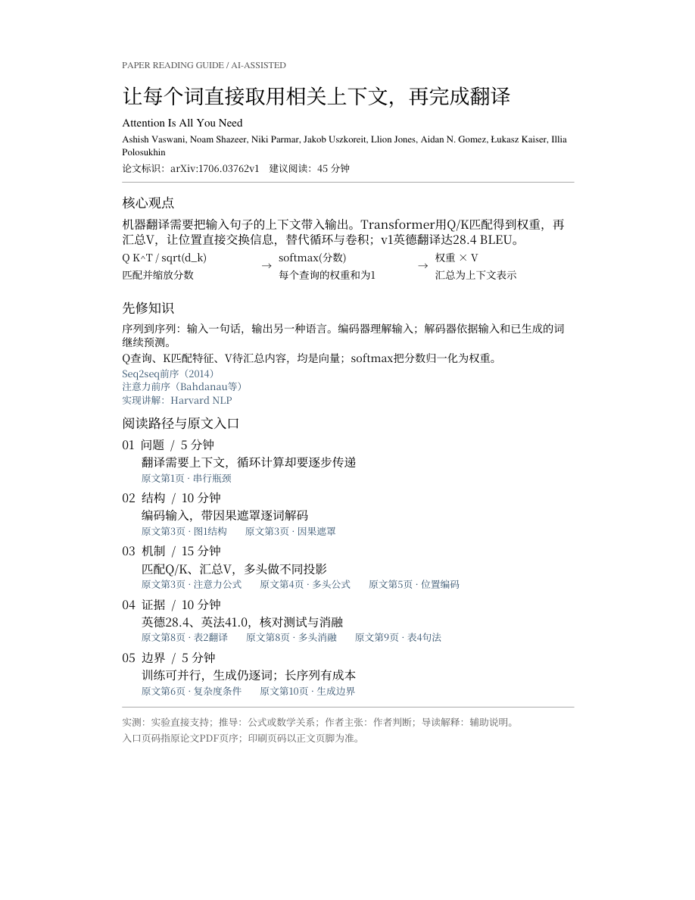

# 主案例：Attention Is All You Need

本例把 Transformer 原论文做成可自己阅读的一页导览、正文旁注和证据入口。固定 **arXiv:1706.03762v1（2017-06-12）**，原文15页；不是套用新版教科书内容，也不是全文翻译。

[导览预览](showcase/preview-guide.png) · [原论文](https://arxiv.org/abs/1706.03762v1) · [标注记录](annotations.json) · [验收记录](../../review/ATTENTION-2026-10-18.md)



## 可以看到什么

- 35条精选：必要术语、长句直译、五处公式说明与关键发现。
- 一页背景和阅读路线，11个PDF内部入口，三条基础/前序资料链接。
- 图1/2、表1–4及附录图3–5均有同页标注；保留未标注的原文和参考文献。
- 明确区分作者主张、实验结果、数学关系与辅助解释；45分钟只是预算。

核心主线是机器翻译任务、位置间的信息交互、Q/K/V计算与对应实验证据，不把训练速度当作全部贡献。

本例尤其注意三处易混淆的地方：训练更并行不等于生成无需串行；表2是测试集、表3是开发集；v1英法成绩41.0是单模型结果，不能说胜过表里所有集成。

## 本地生成

从仓库根目录运行（Windows PowerShell，先按根README安装依赖）：

```powershell
.\.venv\Scripts\python.exe scripts/fetch_example.py --example attention-is-all-you-need
.\.venv\Scripts\python.exe scripts/prepend_guide.py local/attention-is-all-you-need-v1.pdf examples/attention-is-all-you-need/annotations.json local/attention-preview/attention-is-all-you-need-v1-reading-brief.pdf
.\.venv\Scripts\python.exe scripts/annotate.py local/attention-is-all-you-need-v1.pdf examples/attention-is-all-you-need/annotations.json local/attention-preview/attention-is-all-you-need-v1-annotated.pdf
.\.venv\Scripts\python.exe scripts/verify.py local/attention-is-all-you-need-v1.pdf examples/attention-is-all-you-need/annotations.json local/attention-preview/attention-is-all-you-need-v1-annotated.pdf
.\.venv\Scripts\python.exe scripts/mobile.py local/attention-is-all-you-need-v1.pdf examples/attention-is-all-you-need/annotations.json local/attention-preview/attention-is-all-you-need-mobile.html --pdf local/attention-preview/attention-is-all-you-need-v1-annotated.pdf
```

输出在local/attention-preview/。导览PDF保留原研究页对象；标注PDF添加高亮和旁注。两者均为1页导览＋15页论文。HTML直接显示同一标注PDF的页面，打开PDF按钮需要对应PDF在同目录。

这组命令不调用模型API，只从现成JSON重建产物。处理新论文仍需智能体阅读并编写新的记录。

## 复现展示素材

安装可选依赖requirements-showcase.txt后执行：

```powershell
.\.venv\Scripts\python.exe scripts/reading_showcase.py
```

生成静态主海报、注意力机制图、证据路径图的桌面和窄屏版本，以及真实导览预览。全部使用同一JSON和成品PDF；[static-manifest.json](showcase/static-manifest.json)记录裁图坐标、来源和哈希。不再生成动图，不公开完整研究页或全文HTML。

## 来源与范围

原文SHA256：`0a9bff1be3575cf9fe26a4a3d3a9175bc791ecec90de8b9deba4cff75d2b9476`。

原文页面列的是[arXiv非独占分发许可](https://arxiv.org/licenses/nonexclusive-distrib/1.0/license.html)，不是CC BY 4.0；没有取得可上传完整研究内容的通用授权。因此公开仓库提供原文入口、选择性引文和自己的解释数据，以及本地生成方式，完整阅读副本留在本机。公开预览中的原文标题、少量原句等归原作者，中文解释和新增代码按仓库MIT。

已通读正文1–10页和附录图注13–15页；参考文献10–12页核对条目但未逐篇研读。机械检查通过不能代替专业审查；独立复核和真实手机操作仍待完成，集中见[TODO](../../TODO.md)。
